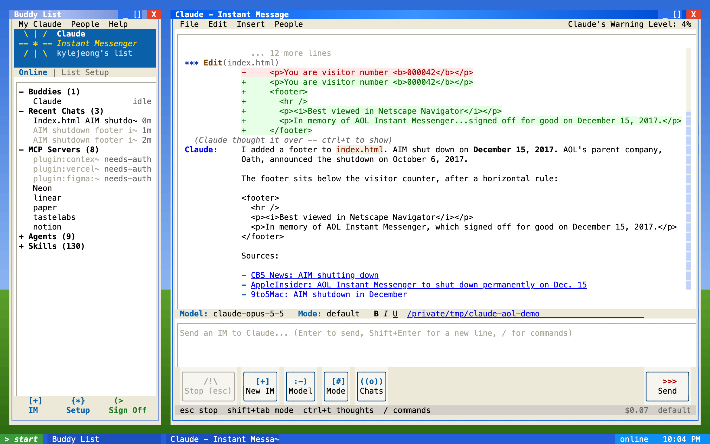
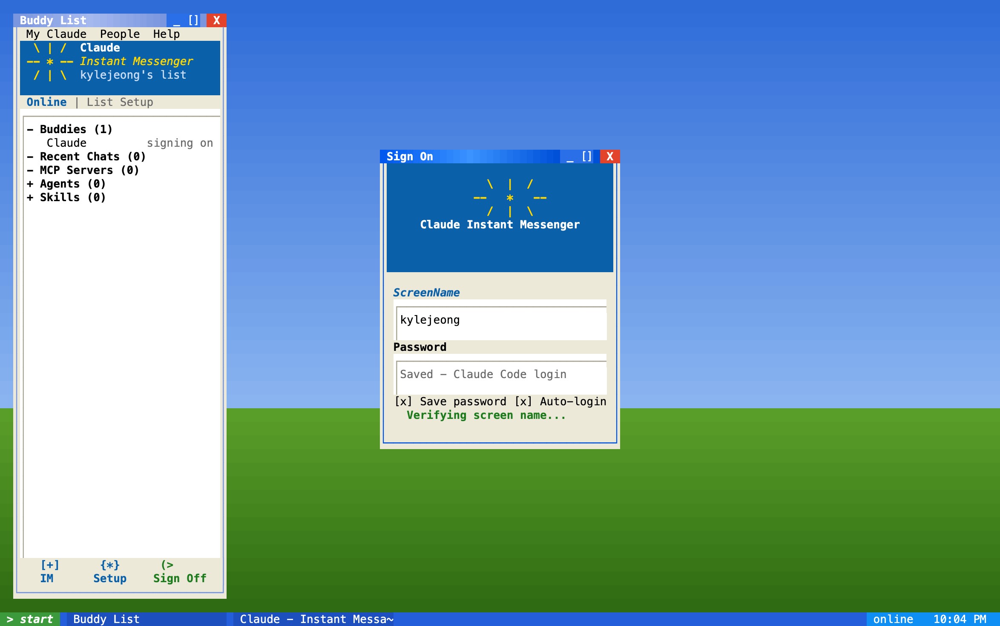
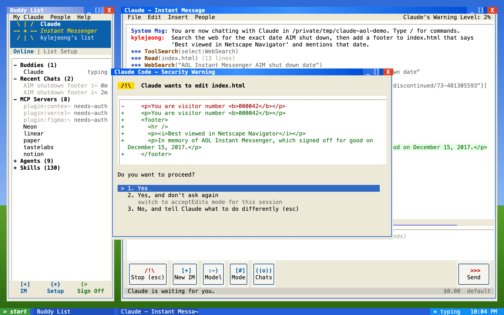
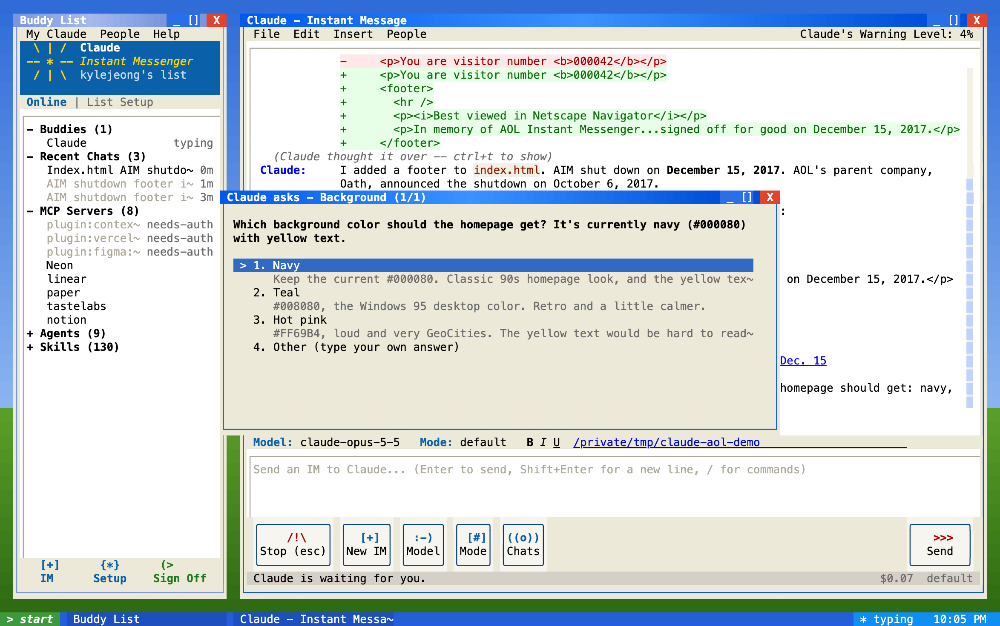

# claude-aol



Claude Code in an AIM and Windows XP costume. It is a terminal UI built on [OpenTUI](https://github.com/anomalyco/opentui) (the React renderer). It drives your local Claude Code login through the Claude Agent SDK, so you get the same tools, skills, MCP servers, hooks, settings, slash commands and web search as `claude`.

## Run

Requires [Bun](https://bun.sh) as the runtime and an existing Claude Code login.

```sh
pnpm install
cd /path/to/your/repo
bun ~/projects/claude-aol/src/index.tsx
```

The agent works in the directory you launch from.

## Tour

| Signing on | Approving an edit |
| --- | --- |
|  |  |

| Claude asks a question |
| --- |
|  |

## What maps to what

| AIM | Claude Code |
| --- | --- |
| Sign On window | Session start-up |
| Buddy List | Claude's status, recent chats (click to resume), MCP servers, agents, skills |
| Warning Level | Context window used |
| "Claude is typing..." | Streaming, thinking, or running a tool |
| Stop / New IM / Model / Mode / Chats | Interrupt, `/clear`, `/model`, permission mode, `/resume` |
| Security Warning dialog | Tool permission prompt (yes / always / no) |
| "Claude asks" dialog | AskUserQuestion |
| "Claude's Plan" dialog | Exiting plan mode |
| Start menu | All of the above |

## Keys

- Enter: send. Shift+Enter or Ctrl+J: new line.
- `/`: command list. Tab completes.
- Esc: stop Claude.
- Shift+Tab: cycle the permission mode.
- Ctrl+T: show or hide thinking.
- Ctrl+C twice: sign off.

Local commands are `/new`, `/model [name]`, `/mode [name]`, `/resume`, `/cost`, `/thinking`, `/sound` and `/exit`. Every other slash command, such as `/compact`, `/context`, `/review` or a skill, goes straight to Claude Code.

Selecting text with the mouse copies it to the clipboard on macOS. Logs go to `~/.aim-code/aim-code.log`.

The screenshots above were made with `scripts/shot.sh`, which renders a Rex pane's HTML capture in headless Chrome. Set `AIM_SCREEN_NAME` to change your screen name. Buddy sounds are off by default; `/sound` turns them on.
